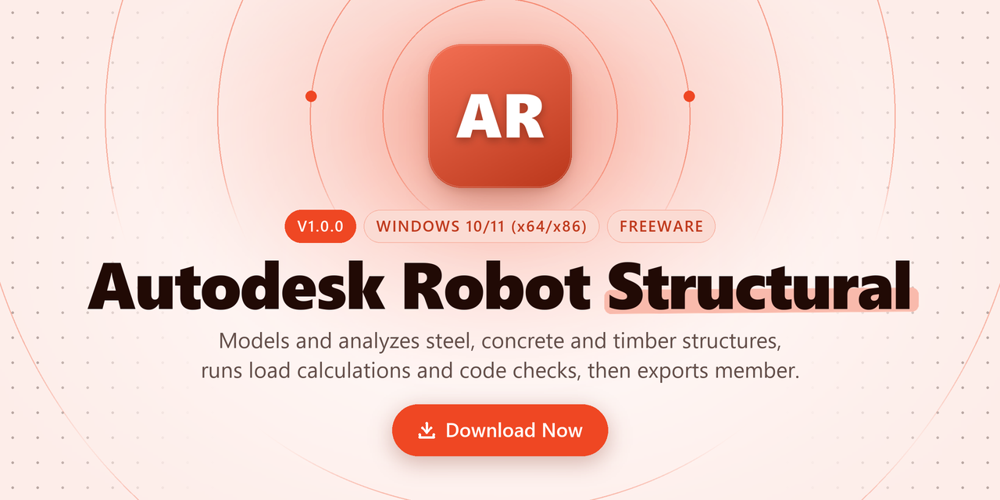

<h1 align="center">Autodesk Robot Structural - Structural Analysis and Code Checking on Windows 10/11</h1>

<p align="center"><i>Autodesk Robot Structural Analysis Professional is a finite element and code-checking environment for steel, concrete, and timber structures on Windows. This page documents requirements, configuration paths, CLI flags, shortcuts, and field-tested fixes for engineers and BIM coordinators who run the product in production.</i></p>

<p align="center">&nbsp;&nbsp;&nbsp;&nbsp;&nbsp;&nbsp;&nbsp;&nbsp;</p>

<p align="center"></p>

<p align="center">
  <a href="https://quietworksapi292.github.io/autodesk-robot-structural/">
    <picture>
      <source media="(prefers-color-scheme: dark)" srcset="./assets/Click-dark.svg">
      
    </picture>
  </a>
</p>

## Table of Contents

<p align="center"><a href="#overview">Overview</a> &nbsp;|&nbsp; <a href="#requirements">Requirements</a> &nbsp;|&nbsp; <a href="#key-features">Key Features</a> &nbsp;|&nbsp; <a href="#configuration">Configuration</a> &nbsp;|&nbsp; <a href="#analysis-engine-comparison">Analysis Engine Comparison</a> &nbsp;|&nbsp; <a href="#keyboard-shortcuts">Keyboard Shortcuts</a> &nbsp;|&nbsp; <a href="#command-line-options">Command-Line Options</a> &nbsp;|&nbsp; <a href="#troubleshooting">Troubleshooting</a> &nbsp;|&nbsp; <a href="#faq">FAQ</a> &nbsp;|&nbsp; <a href="#notes">Notes</a></p>

## Overview

### What It Does

Robot builds a finite element model from scratch, from DWG/DXF, or from a Revit analytical model, applies load cases and combinations, solves static and dynamic analyses, then runs design code checks against national annexes and exports member schedules, reinforcement drawings, and calculation reports.

### Who It Is For

Structural engineers, BIM coordinators, and checking engineers who need a single model to survive from concept loads through construction-issue documentation. The workflow assumes familiarity with member release, panel meshing, and code parameter sets rather than a guided wizard.

### What Ships in the Build

The installer delivers the Robot core solver, the RC Design and Steel Design modules, the Timber Design module, the Autodesk Structural Analysis Toolkit for link export, the Job Preferences editor, and the `Robot`/`RobotCalc` command binaries used for headless batch runs.

## Requirements

| Spec | Minimum | Recommended |
|---|---|---|
| OS | Windows 10 64-bit (1809+) | Windows 11 64-bit (23H2+) |
| CPU | 4 cores, SSE4.2, 2.5 GHz | 8+ cores, 3.5 GHz, AVX2 |
| RAM | 8 GB | 32 GB (16 GB for models under 50k DOF) |
| GPU / display | DirectX 11, 1920x1080 | Discrete GPU, 2560x1440, 4 GB VRAM |
| Storage | 25 GB free on system drive | 60 GB free on NVMe SSD |
| Solver temp space | 2x model file size | Dedicated scratch volume, 4x model size |

## Key Features

* **FEM Solver** , assembles and solves static, modal, buckling, seismic, and time-history cases on 32/64-bit sparse matrices.
* **Code Checks** , validates members and panels against Eurocode, AISC, ACI, CSA, and 30+ national annexes.
* **Load Combination Generator** , builds automatic combinations from selected codes and manual case sets.
* **Revit Analytical Link** , round-trips geometry, sections, and boundary conditions with Revit via the Analytical Model exchange.
* **RC and Steel Design Modules** , produces reinforcement schedules, connection checks, and member utilization tables.
* **Drawing Export** , generates member schedules and reinforcement drawings to DWG with layer mapping.
* **Batch Calculator** , runs queued `.rtd` models through `RobotCalc` without the GUI.
* **API and Toolkit** , exposes the Robot API for scripting model edits, result extraction, and report automation.

## Configuration

### Configuration files and folders

| Path | Purpose |
|---|---|
| `%APPDATA%\Autodesk\Robot Structural Analysis Professional\` | Per-user preferences, recent files, UI layout, and ribbon customizations |
| `%LOCALAPPDATA%\Autodesk\Robot Structural Analysis Professional\` | Local cache, solver scratch data, and crash recovery snapshots |
| `%PROGRAMDATA%\Autodesk\Robot Structural Analysis Professional\` | Shared code parameter sets, section databases, and material libraries |
| `%PROGRAMDATA%\Autodesk\RLM\` | Network license configuration and license server pointers |
| `%APPDATA%\Autodesk\Structural Analysis Toolkit\` | Revit link settings and analytical export preferences |
| `%PROGRAMDATA%\Autodesk\ApplicationPlugins\` | Installed add-ins, API extensions, and loadable modules |

### Key settings

| Setting | Default | Notes |
|---|---|---|
| Solver thread count | Auto (all cores) | Cap to cores minus 1 for responsiveness during long solves |
| Auto-save interval | 10 min | Raise to 20 for large models on slow disks; lower for unstable sessions |
| Undo memory limit | 512 MB | Increase to 2 GB for models with heavy panel editing |
| Update channel | Standard | Switch to `Beta` only on non-production workstations |
| Telemetry / usage data | On | Controlled by Autodesk account privacy settings, not the installer |
| Default design code | Eurocode (EN) | Change per project in Job Preferences > Design Codes |
| Result cache location | `%LOCALAPPDATA%` | Point to SSD scratch volume for models over 100 MB |

## Analysis Engine Comparison

| Engine | DOF ceiling (practical) | Typical solve (10k DOF, 8 cores) | Memory per 100k DOF | When to pick |
|---|---|---|---|---|
| Direct sparse (default) | ~2M | 8 to 15 s | ~1.2 GB | Most building and bridge models |
| Iterative (PCG) | ~20M | 4 to 9 s | ~0.4 GB | Large shell-dominated models, well-conditioned |
| Modal (Lanczos) | ~500k | 20 to 60 s per 30 modes | ~1.8 GB | Seismic and dynamic response cases |
| Time history | ~200k | 2 to 5 min per run | ~2.5 GB | Non-linear and transient load records |

Pick direct sparse unless a run fails on memory or exceeds 60 s. Switch to iterative only after a direct solve confirms conditioning; time history is reserved for records with validated damping input.

## Keyboard Shortcuts

| Action | Shortcut |
|---|---|
| Open Job Preferences | `Ctrl+Shift+P` |
| Run calculation (all cases) | `F5` |
| Run selected load case | `Ctrl+F5` |
| Regenerate model / mesh | `Ctrl+G` |
| Toggle selection filter | `Ctrl+L` |
| Zoom extents | `Ctrl+Shift+E` |
| Open code parameter editor | `Ctrl+Shift+C` |
| Export drawing to DWG | `Ctrl+Shift+D` |
| Copy result table to clipboard | `Ctrl+C` in Results tab |
| Open API console / log window | `Ctrl+Shift+~` |

## Command-Line Options

| Flag | Argument | Purpose |
|---|---|---|
| `-i` | `model.rtd` | Input model file for batch processing |
| `-c` | `case_list` | Comma-separated load cases to solve |
| `-o` | `results.csv` | Write result tables to a file |
| `-b` | `code_set` | Apply a design code parameter set |
| `-j` | `job.json` | Load a Job Preferences profile for the run |
| `-l` | `log.txt` | Append solver log to a file |
| `-n` | `threads` | Override solver thread count |
| `-q` | none | Quiet mode, suppress GUI dialogs and progress |

```bash
RobotCalc.exe -i "C:\Projects\Warehouse\Model.rtd" -c "DL,LL,WL" -o "results.csv" -b "EC3" -j "job.json" -l "solve.log" -n 6 -q
```

| Exit Code | Meaning |
|---|---|
| 0 | Solved cleanly, all cases converged |
| 2 | Partial convergence, one or more cases hit max iterations |
| 3 | Model validation failure (geometry or boundary conditions) |
| 4 | License unavailable or seat exhausted |
| 5 | Output write failure (path or permissions) |

## Troubleshooting

### Solver stalls at "assembling stiffness matrix"

The status bar freezes for more than 10 minutes on a model that normally solves in under one.

1. Open Job Preferences and reduce solver thread count to cores minus 2.
2. Check `%LOCALAPPDATA%\...\` for a stale scratch file and delete folders older than 24 h.
3. Confirm result cache is not on a network share; move it to local NVMe.
4. Split the model by story or zone and solve each submodel to isolate the offending panel cluster.

### Revit analytical link drops sections

Members arrive in Robot with default sections instead of the families assigned in Revit.

1. Verify the Structural Analysis Toolkit version matches the Robot build year.
2. In Revit, run Analyze > Analytical Model > Check Consistency before export.
3. Map family names to Robot section databases under Job Preferences > Section Mapping.
4. Re-export via the Analytical Link, not plain DWG, and confirm the log shows zero skipped members.

### Drawing export produces empty or mislayered DWG

The DWG opens in AutoCAD with no visible member schedules or all geometry on layer 0.

1. Open Job Preferences > Drawing Export and confirm the layer mapping template is set.
2. Check that the output path is local or fully qualified UNC with write access.
3. Rerun `RobotCalc.exe` with `-l` to capture export errors in the log.
4. If layers still collapse, reset the DWG template from `%PROGRAMDATA%\...\Drawing\`.

### License checkout fails on launch

Robot reports "no license available" despite an active subscription.

1. Check `%PROGRAMDATA%\Autodesk\RLM\` for the license server pointer and confirm the host is reachable.
2. Run the Autodesk licensing service repair from the installer's Tools menu.
3. Clear `%LOCALAPPDATA%\Autodesk\Robot Structural Analysis Professional\Licensing\` cache and relaunch.
4. Verify the seat is not held by a crashed session on another workstation and release it from the Autodesk account portal.

## FAQ

### Can RobotCalc run without a GUI session on Windows Server or a build agent?

Yes, provided an interactive session or a configured licensing service account is available. `RobotCalc.exe` operates headless with `-q`, but the license checkout still requires network access to the Autodesk license endpoint or an on-premises RLM server.

### How do I keep design code parameter sets in sync across a team?

Store shared parameter sets under `%PROGRAMDATA%\Autodesk\Robot Structural Analysis Professional\` on a redirected or DFS-backed share, then point each workstation's Job Preferences to that path. Version the folder with your usual source control so code annex updates are traceable.

### Why do result tables differ between two workstations solving the same model?

Differences almost always trace to solver thread count, an outdated design code parameter set, or a mismatched Robot build. Normalize `-n`, confirm the parameter set hash, and re-run both workstations against the same `job.json` profile before comparing outputs.

## Notes

Autodesk, Robot Structural Analysis Professional, and Revit are trademarks of Autodesk, Inc. This page documents configuration and operational behavior for Windows deployments and is not affiliated with or endorsed by Autodesk. Verify code annexes and licensing terms against your subscription agreement.